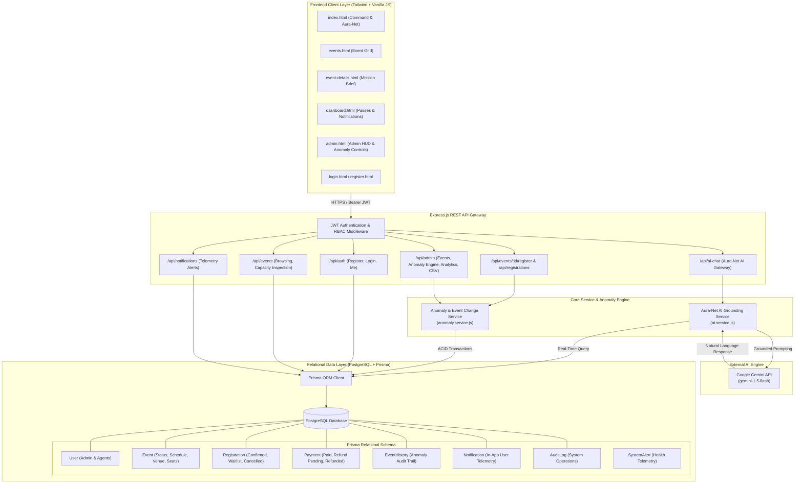
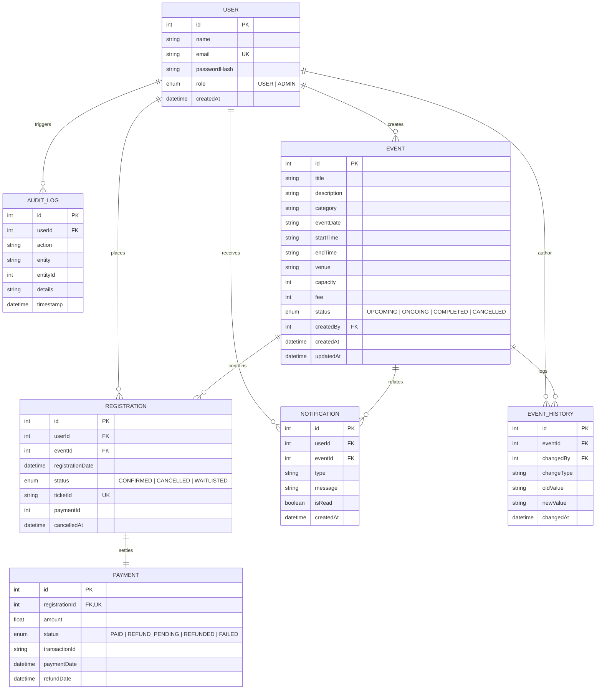
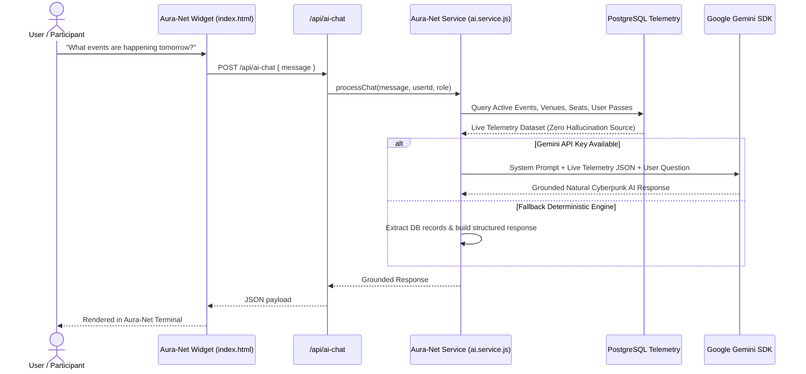

# QUANTUM NET // SYSTEM ARCHITECTURE & TELEMETRY PROTOCOL

QUANTUM NET is a full-stack cosmic event management and AI telemetry platform engineered with **Node.js, Express.js, PostgreSQL (Prisma ORM), Tailwind CSS**, and **Google Gemini AI**.

---

## 1. High-Level System Architecture

---

## 2. Relational Database Schema Diagram

---

## 3. Registration Workflow & Capacity Lock

```mermaid
sequenceDiagram
    autonumber
    actor Agent as User / Agent
    participant Web as Frontend UI
    participant API as Express API (/api/events/:id/register)
    participant Engine as Anomaly Engine (anomaly.service.js)
    participant DB as PostgreSQL (Prisma $transaction)

    Agent->>Web: Click "Initialize Registration"
    Web->>API: POST /api/events/:id/register (Bearer JWT)
    API->>Engine: registerForEvent(eventId, userId)
    
    rect rgb(20, 10, 40)
        Note over Engine,DB: BEGIN TRANSACTION (Atomic Capacity Guard)
        Engine->>DB: Check Event Exists & Status != CANCELLED
        Engine->>DB: Check Event Schedule != Past
        Engine->>DB: Check Duplicate Registration (Active Check)
        Engine->>DB: Count Confirmed Registrations
        
        alt Capacity Available (Confirmed < Capacity)
            Engine->>DB: INSERT Registration (status: CONFIRMED)
            Engine->>DB: Generate Ticket ID (e.g. QN-2026-00001)
            Engine->>DB: INSERT Payment (status: PAID)
            Engine->>DB: INSERT Notification ("Registration confirmed...")
            Engine->>DB: INSERT AuditLog ("REGISTER_EVENT")
            DB-->>Engine: Commit Transaction
            Engine-->>API: { success: true, ticketId: "QN-2026-00001", status: "CONFIRMED" }
        else Capacity Full
            Engine->>DB: INSERT Registration (status: WAITLISTED)
            Engine->>DB: INSERT Notification ("Placed on priority waitlist...")
            Engine->>DB: INSERT AuditLog ("WAITLIST_ENTRY")
            DB-->>Engine: Commit Transaction
            Engine-->>API: { success: true, status: "WAITLISTED", isWaitlisted: true }
        end
    end

    API-->>Web: 201 Created Response
    Web-->>Agent: Render Cosmic Ticket Badge / Waitlist Status
```

---

## 4. Anomaly Engine Workflows

### Anomaly 1: Event Cancellation & Cascading Rollback
1. Admin triggers `PATCH /api/admin/events/:id/cancel`
2. **Transaction starts**:
   - `Event.status` $\rightarrow$ `CANCELLED`
   - All `CONFIRMED` registrations $\rightarrow$ `CANCELLED` (`cancelledAt = now`)
   - All associated `PAYMENT` records $\rightarrow$ `REFUND_PENDING` (`refundDate = now`)
   - Broadcast notifications dispatched to all affected users: `"[Event] has been cancelled. Your registration has been cancelled and your refund is being processed."`
   - `EventHistory` recorded (`EVENT_CANCELLATION: UPCOMING -> CANCELLED`)
   - `AuditLog` recorded.

### Anomaly 2: Participant Deregistration & Waitlist Promotion
1. User clicks **WITHDRAW** on Dashboard $\rightarrow$ `DELETE /api/registrations/:id`
2. **Transaction starts**:
   - Registration status $\rightarrow$ `CANCELLED`
   - Payment status $\rightarrow$ `REFUND_PENDING`
   - User notification created.
   - **Waitlist Check**: Finds first `WAITLISTED` participant ordered by registration timestamp.
   - Promotes waitlisted user $\rightarrow$ `CONFIRMED`, generates unique ticket ID `QN-YYYY-XXXXX`, creates payment record, and sends promotion notification.

### Anomaly 3: Venue Change & Conflict Verification
1. Admin enters new venue $\rightarrow$ `PATCH /api/admin/events/:id/venue`
2. **Conflict Check**: Verifies if any other active event occupies the new venue on the same date/time. If conflict, **REJECTS** with `"Venue conflict detected. The selected venue is already occupied during this time."`
3. If valid:
   - Updates `Event.venue`
   - Creates `EventHistory` log (`VENUE_CHANGE: Old -> New`)
   - Dispatches in-app notification to all confirmed participants: `"The venue for [Event] has changed from [Old] to [New]."`
   - Creates `AuditLog`.

### Anomaly 4: Capacity Reduction Enforcement
1. Admin attempts to reduce capacity to $N$.
2. Anomaly Engine counts active confirmed participants $C$.
3. If $N < C$, transaction is immediately **REJECTED** with:
   `"Capacity cannot be reduced below the current number of confirmed registrations."`

---

## 5. Aura-Net AI Grounding Architecture

